# Manual Book — Koperasi App

**Versi Dokumen:** 2.0
**Terakhir Diperbarui:** 25 Agustus 2026
**Status Aplikasi:** Development — seluruh alur bisnis inti + modul pendukung berjalan, test suite 110/110 hijau

---

## 1. Gambaran Umum

Koperasi App adalah sistem simpan pinjam internal untuk mengelola keanggotaan, simpanan, pinjaman, kas koperasi, percepatan tenor, pengajuan limit, pengeluaran, resign/reaktivasi, dan pelaporan. Dibangun dengan Laravel 13 + Inertia + React + Tailwind, database MySQL (test: SQLite in-memory).

**Role yang tersedia saat ini:**

| Role | Fungsi Utama |
|---|---|
| **Admin** | Kelola data anggota, resign & reaktivasi, kelola pengaturan sistem, kelola role & hak akses |
| **Bendahara** | Input/konfirmasi simpanan, tinjau pinjaman (tahap 1), konfirmasi angsuran, verifikasi pencairan mandiri Ketua, kelola kas, catat pengeluaran, cetak laporan |
| **Ketua Koperasi** | Approval final pinjaman (tahap 2), approval perubahan tenor, persetujuan limit khusus, cetak laporan |
| **Anggota** | Ajukan pinjaman, ajukan limit khusus, ajukan perubahan tenor/pelunasan, lihat saldo & riwayat via portal |

### 1.1 Tampilan Autentikasi Sistem

Aplikasi mendukung autentikasi lokal (pengembangan) dan Single Sign-On (GATE SSO SAML2) dengan antarmuka responsif:

| Login Desktop (1440x900) | Login Mobile (390x844) |
|---|---|
| 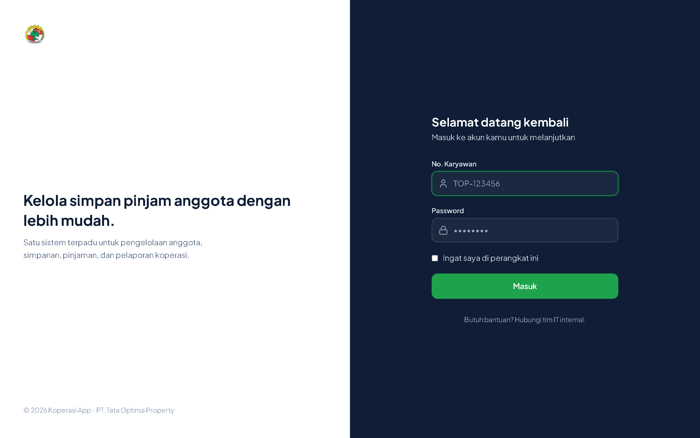 | 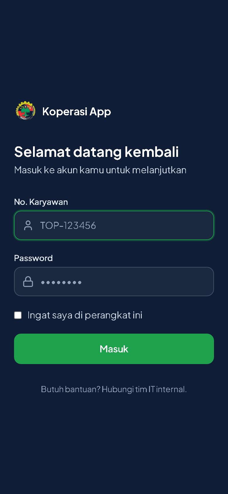 |

---

## 2. Dashboard Koperasi

Dashboard menyajikan metrik keuangan real-time, saldo kantong kas, pinjaman aktif, serta peringatan tindak lanjut:

### 2.1 Dashboard Admin & Pengurus
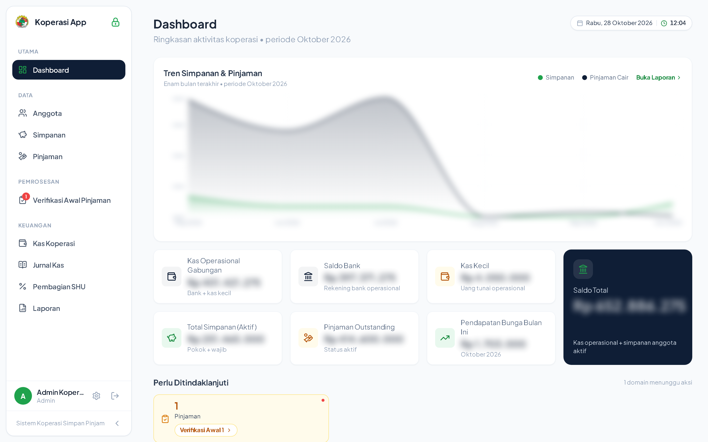

### 2.2 Dashboard Pengawas (Read-Only Audit & Monitoring)
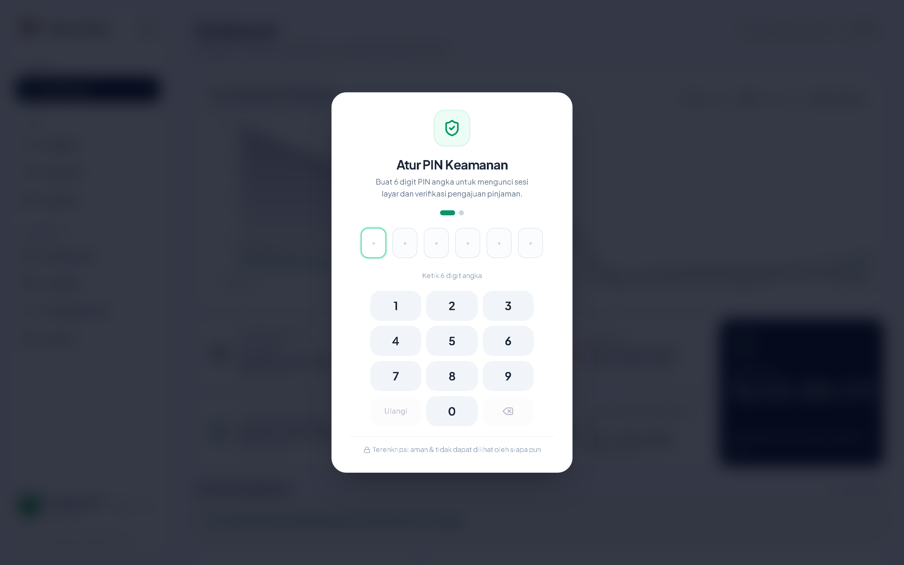

---

## 3. Alur Bisnis per Modul

### 2.1 Keanggotaan

1. Admin membuka menu **Anggota** → **Tambah Anggota**
2. Isi: nama, no_karyawan, email, cabang, unit bisnis, jabatan (Staff/HOD), department, tanggal mulai kerja, tanggal jadi anggota
3. Sistem otomatis:
   - Membuat No. Anggota (format `ANG-2026-0001`)
   - Membuat akun login User dengan role `anggota` dan flag `harus_ganti_password = true` (wajib ganti password saat login pertama)
   - Mencatat Simpanan Pokok sesuai nominal di Pengaturan
   - Mencatat jurnal `simpanan_pokok_masuk` ke kantong Simpanan Anggota

### 3.2 Simpanan & Pengeluaran Kas

Ada 3 jenis simpanan:

| Jenis | Kapan Tercatat | Kantong Kas | Catatan |
|---|---|---|---|
| Pokok | Otomatis, sekali saat anggota dibuat | Simpanan Anggota | Nominal diatur di Pengaturan; jurnal `simpanan_pokok_masuk` |
| Wajib | Bulanan, dikonfirmasi manual oleh Bendahara | Simpanan Anggota | Jurnal `simpanan_wajib_masuk` |
| Dana Sosial | Otomatis bersamaan dengan konfirmasi Simpanan Wajib | Dana Sosial | Terpisah dari saldo simpanan anggota; jurnal `dana_sosial_bulanan` |

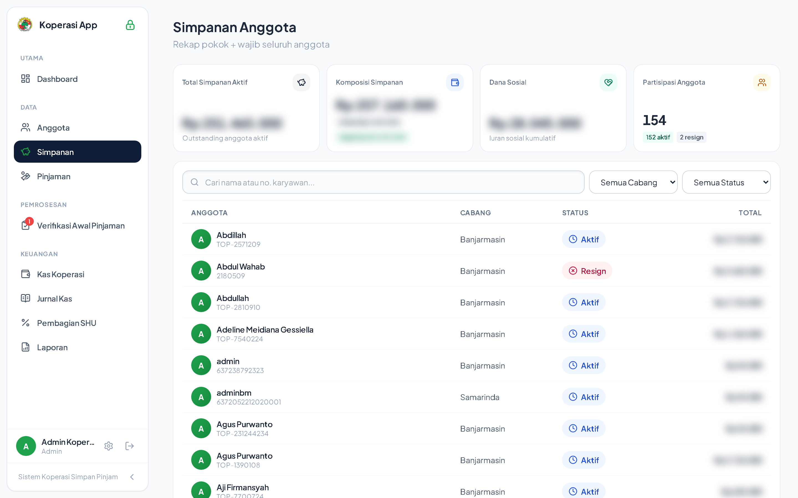

**Alur konfirmasi bulanan** (Bendahara → menu **Konfirmasi Simpanan**):
1. Pilih bulan
2. Sistem tampilkan anggota aktif yang belum ada catatan simpanan wajib bulan itu
3. Centang anggota yang sudah dipotong gajinya (berdasarkan laporan dari tim Payroll)
4. Klik **Konfirmasi Terpilih** — sistem otomatis buat 2 baris (Wajib + Dana Sosial) untuk tiap anggota terpilih

Anggota yang sudah dikonfirmasi sebelumnya otomatis dilewati (dedup).

Pengeluaran operasional dan dana sosial dicatat secara transparan dengan pemotongan kantong otomatis:
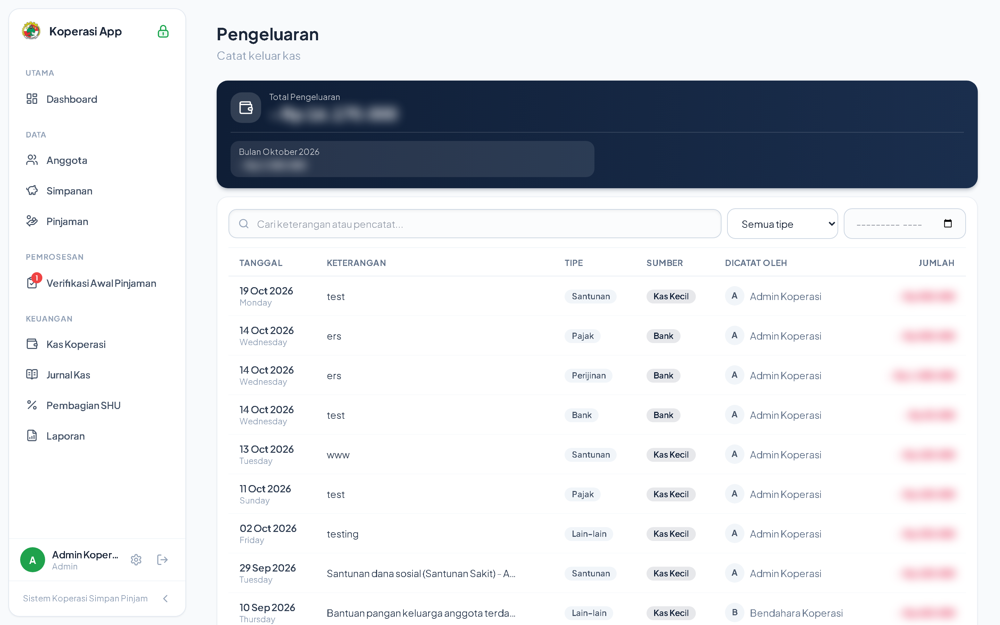

### 3.3 Portal Anggota (Pengajuan & Layanan Mandiri)

Anggota mengakses sistem secara mobile-first melalui Portal Anggota dengan antarmuka modern:

| Dashboard Portal | Formulir Pinjaman |
|---|---|
| 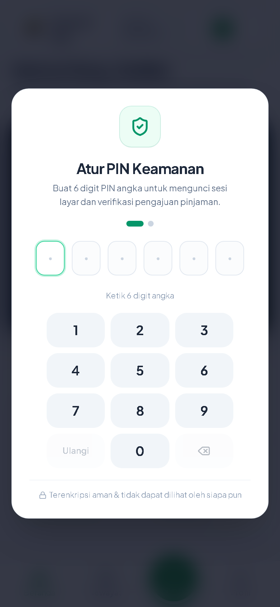 | 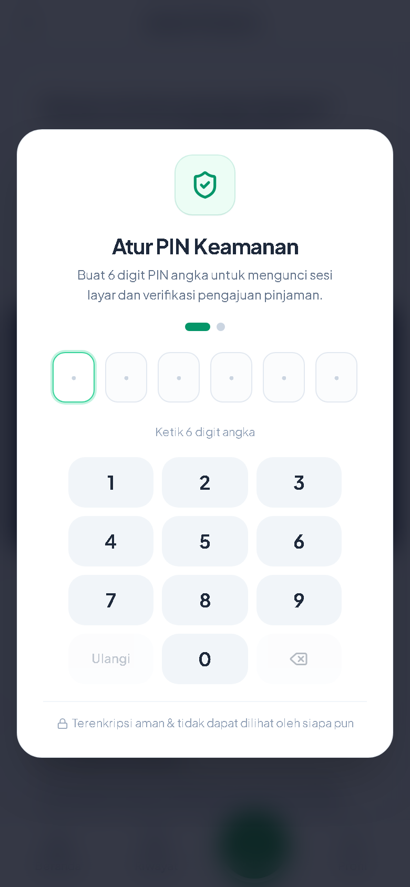 |

| Riwayat Mutasi | Profil & Rekening | Panduan Interaktif |
|---|---|---|
| 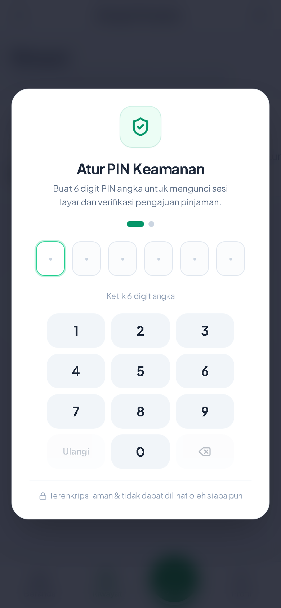 | 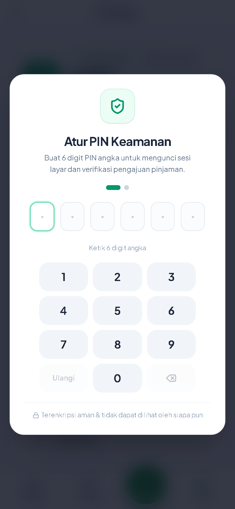 | 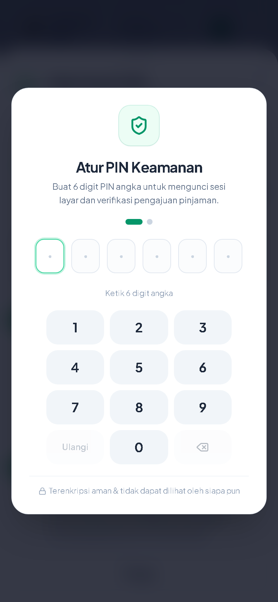 |

Anggota login ke portal → menu **Ajukan Pinjaman**, alur wizard 3 langkah:

1. **Nominal** — sistem cek terhadap limit maksimal anggota tersebut
2. **Tenor** — pilihan dibatasi tenor maksimal sesuai nominal (dari Tabel Tenor di Pengaturan)
3. **Ringkasan** — simulasi cicilan per bulan, konfirmasi pengajuan

Form juga meminta keperluan, bank tujuan pencairan, nomor rekening, atas nama (snapshot tersimpan di pinjaman).

**Aturan limit pinjaman** (bisa diubah di Pengaturan):

| Kategori | Limit Default |
|---|---|
| Anggota < 1 tahun | Rp 1.000.000 |
| Anggota 1–3 tahun | Rp 5.000.000 |
| Anggota 3–5 tahun | Rp 7.000.000 |
| Anggota ≥ 5 tahun | Rp 10.000.000 |

**Limit Khusus (override manual):** Admin bisa mengatur limit berbeda untuk anggota tertentu lewat halaman **Edit Anggota** → bagian "Limit Pinjaman Khusus". Kalau diisi, sistem mengikuti angka ini, bukan kategori otomatis. Wajib disertai alasan, dan tercatat di Audit Log.

**Aturan pengajuan ulang (reloan):**
- Anggota dengan pinjaman aktif harus lunas dulu, KECUALI
- Anggota (bukan kategori <1 tahun) dengan sisa angsuran ≤ 2 kali — boleh ajukan baru **satu kali** per siklus pinjaman

### 3.4 Approval Pinjaman Multi-Jenjang

Proses approval dirancang berjenjang dengan pemisahan tugas (Segregation of Duties) yang ketat:

#### 1. Tampilan Admin (Verifikasi Dokumen & Pipeline)
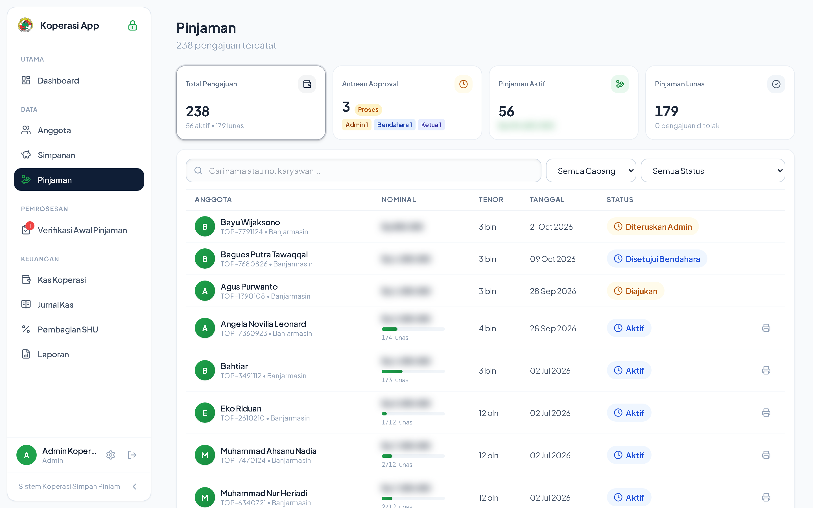

#### 2. Tampilan Bendahara (Evaluasi Keuangan & Likuiditas Kas)
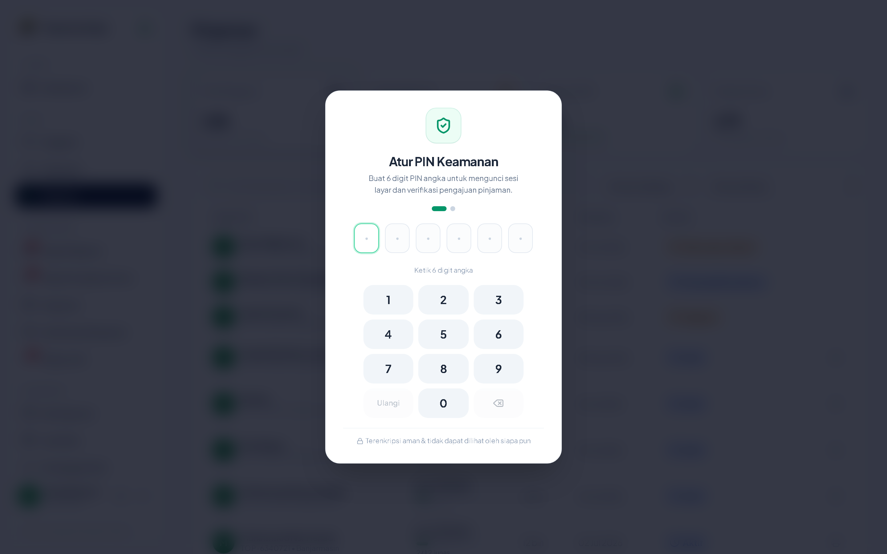

#### 3. Tampilan Ketua Koperasi (Otorisasi Final & Eksekusi Pencairan)
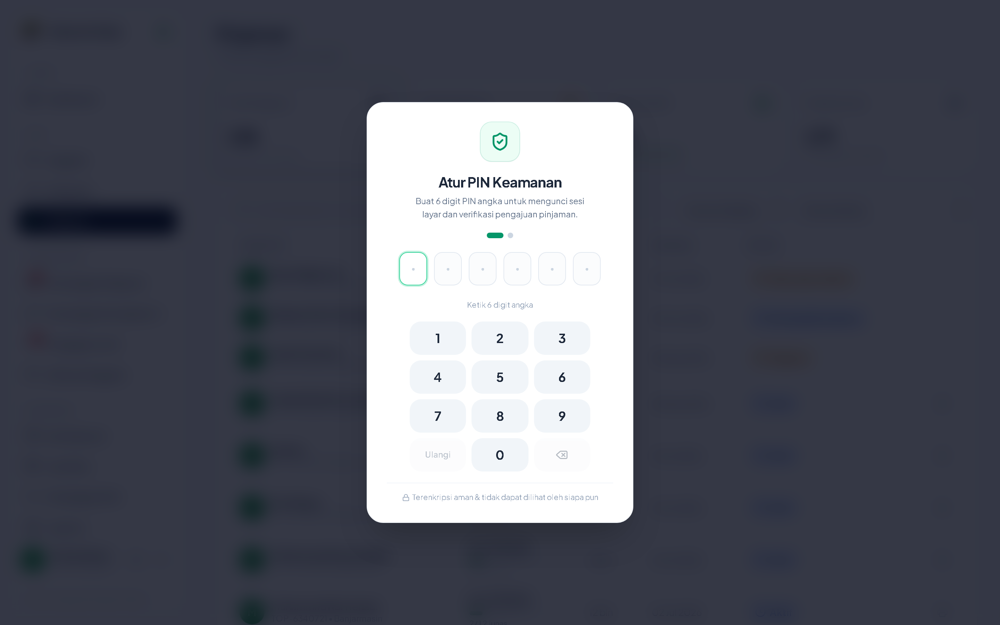

**Alur normal (anggota biasa):**

```
Diajukan (Anggota submit via portal)
    ↓
Bendahara meninjau → Setujui / Tolak (wajib isi catatan min. 5 karakter)
    ↓ (jika disetujui)
Ketua Koperasi meninjau → Setujui / Tolak (wajib isi catatan)
    ↓ (jika disetujui)
Sistem cek saldo kantong Dana Pinjaman mencukupi atau tidak
    ↓ (jika cukup)
Status "Aktif" — jadwal angsuran otomatis dibuat, dana dicairkan, kas berkurang,
WA formal + lampiran Bukti Peminjaman (PDF) dikirim ke anggota
```

**Alur mandiri Ketua (pengajuan sendiri oleh Ketua):**

```
Diajukan oleh Ketua (cair_oleh_bendahara = true)
    ↓
Bendahara meninjau → Setujui (verifikasi dokumen saja, tanpa jurnal)
    ↓
Bendahara mencairkan → Status "Aktif", jadwal angsuran, jurnal pencairan, WA + PDF
```

**Penting:** kalau saldo kantong Dana Pinjaman tidak mencukupi saat approve final, sistem menolak proses pencairan dengan pesan error, meski keputusan administratif sudah "disetujui". Transaksi rollback penuh.

### 2.5 Angsuran

Jadwal angsuran dibuat otomatis saat pinjaman aktif, dengan **bunga menurun** (dihitung dari sisa pokok tiap bulan). Cicilan terakhir menyerap sisa pembulatan supaya Σpokok == nominal persis.

**Alur konfirmasi bulanan** (Bendahara → menu **Konfirmasi Angsuran**):
1. Pilih bulan (navigasi ‹ › + tombol "Bulan ini")
2. Sistem tampilkan semua cicilan jatuh tempo bulan itu (lintas semua anggota)
3. Gunakan search untuk cari nama/no anggota; centang yang sudah dipotong gaji
4. Konfirmasi — sistem otomatis:
   - Update status angsuran jadi lunas
   - Tambah saldo kantong Dana Pinjaman + catat jurnal
   - Kalau semua cicilan lunas → pinjaman otomatis jadi "Lunas"
5. Bar bawah menampilkan jumlah terpilih + total rupiah

Halaman ini juga menampilkan **pendapatan bunga** koperasi (per bulan dan akumulasi keseluruhan).

Badge pada baris angsuran:
- 🔴 **Terlambat** — tanggal jatuh tempo sudah lewat
- 🟡 **Perubahan tenor diajukan** — ada pengajuan percepatan/perpanjangan aktif untuk pinjaman tsb.

### 2.6 Percepatan / Perubahan Tenor

Anggota dengan pinjaman aktif yang belum pernah menggunakan hak ini bisa mengajukan 3 jenis perubahan:

| Jenis | Efek |
|---|-------|
| **Percepat Pelunasan** (tenor diperpendek) | Cicilan bulanan naik, total bunga turun |
| **Perpanjangan Tenor** | Cicilan bulanan turun, total bunga naik |
| **Pelunasan Total** | Satu cicilan final = sisa pokok + bunga 1 bln |

**Alur:**

```
Anggota ajukan (portal) → status "diajukan"
    ↓
Bendahara verifikasi → Setujui / Tolak
    ↓ (jika disetujui)
Ketua setujui → pilih "Berlaku mulai" (bulan ini / bulan depan)
    ↓
Sistem ganti jadwal: angsuran lama jadi "digantikan",
jadwal baru dibuat dari sisa pokok, flag sudah_pakai_percepatan = true
```

Setiap pinjaman hanya boleh menggunakan hak ini **satu kali**. Tidak boleh ada dua pengajuan berjalan bersamaan.

### 2.7 Pengajuan Limit Khusus

Anggota bisa mengajukan kenaikan limit melalui portal:

1. Isi limit yang diminta (harus > limit saat ini) + keterangan
2. Tidak boleh ada pengajuan limit lain yang masih menunggu
3. Bendahara/Ketua tinjau → Setujui / Tolak dengan catatan
4. Bila disetujui → `limit_custom` anggota ter-update + Audit Log tercatat

### 2.8 Kas Koperasi (4 Kantong)

Sistem menggunakan **4 kantong kas** yang saling terpisah:

| Kantong | Fungsi | Sumber Masuk | Sumber Keluar |
|---------|--------|-------------|---------------|
| **Dana Pinjaman** | Dana operasional pinjaman | Topup, pembayaran angsuran, pelunasan resign | Pencairan pinjaman, pengeluaran koperasi |
| **Dana Sosial** | Dana kemanusiaan | Potongan dana sosial bulanan | Santunan/bantuan anggota |
| **Simpanan Anggota** | Titipan pokok + wajib anggota | Simpanan pokok & wajib masuk | Return simpanan (resign) |
| **Pengembalian Simpanan** | Transit proses resign | Masuk dari simpanan anggota (resign) | Dibayar ke anggota |

- Berkurang otomatis saat pencairan pinjaman / pengeluaran
- Bertambah otomatis saat konfirmasi angsuran / topup
- Semua mutasi tercatat di **Riwayat Mutasi** (Jurnal Kas) dengan `saldo_setelah`
- Tab riwayat: Dana Pinjaman / Dana Sosial / Pengembalian Simpanan

### 2.9 Pengeluaran

Bendahara mencatat pengeluaran:

| Jenis | Kantong yang Dipotong | Contoh |
|-------|----------------------|--------|
| **Koperasi** | Dana Pinjaman | ATK, listrik, internet, honor admin |
| **Dana Sosial** | Dana Sosial | Santunan sakit, bantuan banjir, hari raya |

Validasi saldo cukup ditangani otomatis; total per jenis ditampilkan di halaman list.

### 2.10 Resign & Reaktivasi

**Alur Resign** (khusus Admin):
1. Pilih anggota aktif → klik **Resign**
2. Sistem hitung: sisa tagihan pinjaman vs total simpanan (pokok + wajib)
3. Validasi: simpanan harus cukup untuk melunasi pinjaman aktif
4. Proses: simpanan ditarik ke kantong transit "Pengembalian Simpanan" → bayar angsuran/lunas → sisanya dikembalikan ke anggota
5. Status anggota → **resign**, settlement JSON tersimpan, slip PDF tersedia
6. Akun login diblokir otomatis (middleware)

**Alur Reaktivasi:**
1. Pilih anggota resign → klik **Aktifkan Kembali**
2. Isi alasan reaktivasi
3. Status kembali → **aktif**, histori resign tetap tersimpan

### 2.11 Notifikasi WhatsApp

Sistem mengirim pesan WhatsApp otomatis (formal, multi-baris) untuk event penting:

| Event | Penerima | Lampiran |
|-------|----------|----------|
| Pengajuan pinjaman diterima | Anggota + Pengurus | — |
| Disetujui Bendahara | Anggota | — |
| **Disetujui Ketua & dicairkan** | Anggota | **Bukti Peminjaman PDF** |
| Ditolak (Bendahara/Ketua) | Anggota | — |
| Konfirmasi simpanan berhasil | — (toast in-app) | — |

Pesan menggunakan format resmi: kop `*KOPERASI KARYAWAN*`, salam Yth., rincian lengkap, status bold, penutup Hormat kami.

**Anti-spam:** semua pesan masuk antrean FIFO di gateway BAILEYS, dikirim berselisih minimum **2 detik** (`SEND_INTERVAL_MS`). HTTP langsung balas `202` saat masuk antrean — worker Laravel tidak menunggu.

### 3.12 Sisa Hasil Usaha (SHU)

Modul SHU menghitung pembagian hasil usaha koperasi secara proporsional kepada anggota, pengurus, cadangan modal, dan dana pendidikan/sosial:

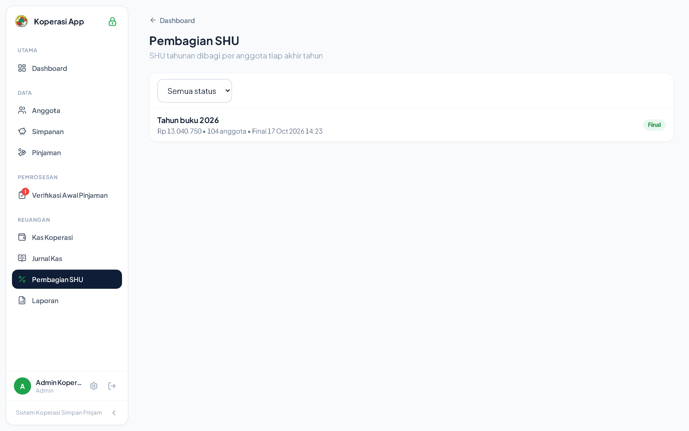

Fitur utama:
- Penentuan persentase pembagian per komponen AD/ART
- Simulasi dan kalkulasi otomatis berbasis jasa modal & jasa anggota
- Finalisasi dan pembayaran massal ke rekening anggota

### 3.13 Laporan

13 laporan siap pakai dengan filter periode + export **PDF & Excel**:

**Keuangan:**
1. **Laporan Arus Kas** — mutasi masuk/keluar per kantong, rentang bebas
2. **Laporan Neraca** — posisi saldo per tanggal cut-off
3. **Pendapatan Bunga** — akumulasi bunga angsuran pinjaman lunas per bulan/tahun (khusus pinjaman)

**Pinjaman:**
4. **Rekap Pinjaman per Status** — daftar pinjaman beserta statusnya
5. **Pinjaman Jatuh Tempo** — angsuran belum dibayar bulan terpilih (follow-up)
6. **Perubahan Tenor** — riwayat pengajuan percepatan/perpanjangan & hasilnya

**Simpanan:**
7. **Rekap Simpanan per Anggota** — akumulasi tiap orang (slip tahunan)
8. **Rekap Setoran Bulanan** — tren penerimaan wajib & dana sosial per bulan

**Anggota:**
9. **Daftar Anggota** — aktif/nonaktif + breakdown cabang & lama keanggotaan
10. **Laporan Resign** — siapa resign, kapan, nilai simpanan dikembalikan

**Operasional:**
11. **Rekap Pengeluaran** — per jenis (Koperasi/Dana Sosial), per periode
12. **Rekap Dana Sosial** — terkumpul vs tersalurkan + sisa saldo
13. **Laporan Audit** *(admin saja)* — jejak aktivitas: siapa ubah apa kapan

Semua laporan punya: filter periode auto-terapkan, tombol Excel/PDF selalu terlihat, tabel responsif dengan kolom pertama sticky, empty state dinamis.

---

## 4. Pengaturan Sistem (Khusus Admin & Super Admin)

Diakses lewat menu Pengaturan, **dilindungi PIN Keamanan 6 digit** setiap sesi untuk melindungi parameter keuangan sensitif dan kontrol akses:

### 4.1 Kebijakan Bunga, Limit, dan Tenor
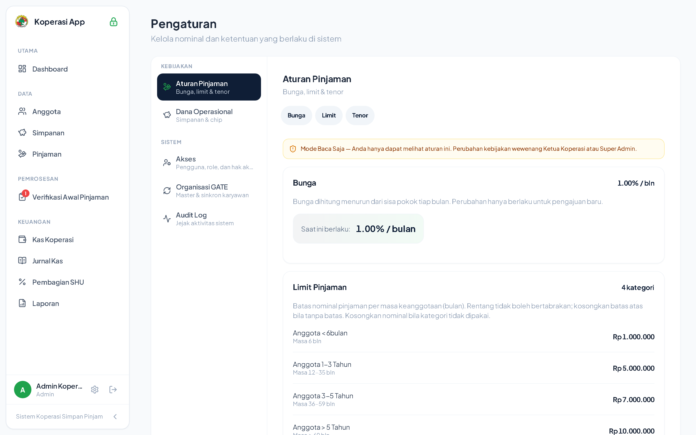

| Tab | Isi |
|---|---|
| **Bunga** | Persentase bunga pinjaman aktif. Perubahan hanya berlaku untuk pengajuan baru. |
| **Limit Pinjaman** | Nominal limit per kategori (<1th, 1–3th, 3–5th, >5th) |
| **Tenor** | Rentang nominal pinjaman → tenor maksimal (10 rentang, sampai 10jt) |
| **Simpanan** | Nominal Simpanan Pokok, Simpanan Wajib, Dana Sosial |
| **WhatsApp** | Status gateway BAILEYS, QR scan untuk pairing, logout session |

### 4.2 Audit Log Aktivitas Sistem
Setiap perubahan data penting, mutasi keuangan, otorisasi pinjaman, dan modifikasi pengaturan terekam secara otomatis dan permanen:

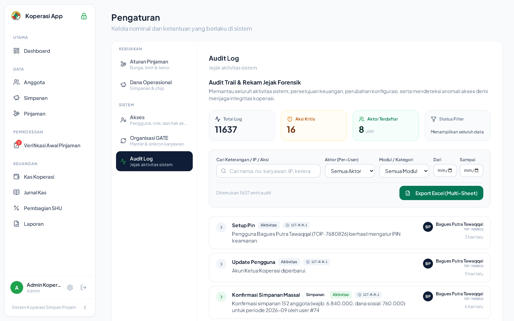

---

## 5. Generator Dokumentasi Visual Otomatis (Playwright)

Seluruh tangkapan layar dalam manual book ini dihasilkan secara otomatis menggunakan **Playwright Test Runner**.

### Perintah Regenerasi Screenshot:
```bash
npm run docs:screenshots
```

Perintah ini akan secara otomatis:
1. Menjalankan browser Chromium headless beresolusi Retina 2x (`deviceScaleFactor: 2`).
2. Melakukan simulasi login lintas role (Admin, Bendahara, Ketua, Pengawas, Anggota).
3. Melakukan otentikasi PIN keamanan area sensitif secara otomatis.
4. Menangkap tangkapan layar Desktop (`1440x900`) dan Mobile (`390x844`).
5. Menyimpan berkas gambar langsung ke `docs/screenshots/<kategori>/`.

---

## 6. Hal yang Perlu Diperhatikan / Pengembangan Lanjutan

- **Tutup Buku periode** — proses tutup buku formal belum ada.
- **Multi-tenant** — belum direncanakan implementasinya.
- **Kelola User Staff via UI** — kelola pengguna & role sudah tersedia di tab Akses Pengaturan.
- **Halaman Profil Portal** — sudah dilengkapi nomor rekening default dan riwayat pinjaman.
- **Edit ajuan pinjaman oleh Bendahara/Ketua** — approval nominal disesuaikan dengan limit.
- **Notifikasi WA untuk konfirmasi simpanan & angsuran** — toast in-app aktif, antrean gateway Baileys beroperasi.

---

## 7. Istilah Penting

- **Reloan** — pengajuan pinjaman baru saat pinjaman lama belum lunas sepenuhnya, hanya boleh dengan syarat tertentu (lihat 3.3)
- **Limit Custom / Limit Khusus** — pengecualian limit pinjaman untuk anggota tertentu
- **Dana Sosial** — potongan dari simpanan wajib yang dicatat terpisah, tidak termasuk saldo simpanan pribadi anggota
- **Audit Log** — jejak setiap perubahan data sensitif
- **Kantong Kas** — pemisahan saldo kas menjadi 4 kantong independen (Dana Pinjaman, Dana Sosial, Simpanan Anggota, Pengembalian Simpanan)
- **Percepatan / Perubahan Tenor** — pengajuan untuk mengubah jadwal angsuran (perpendek/perpanjang/lunas total), hanya 1× per siklus pinjaman
- **Settlement** — ringkasan keuangan saat resign: sisa tagihan pinjaman, simpanan yang dikembalikan, dana sosial yang hangus
- **Bukti Peminjaman** — dokumen PDF resmi berisi detail pinjaman & jadwal angsuran, dilampirkan via WA saat pinjaman dicairkan
- **Saldo Awal** — jurnal pembuka untuk setiap kantong kas agar neraca konsisten dari awal
